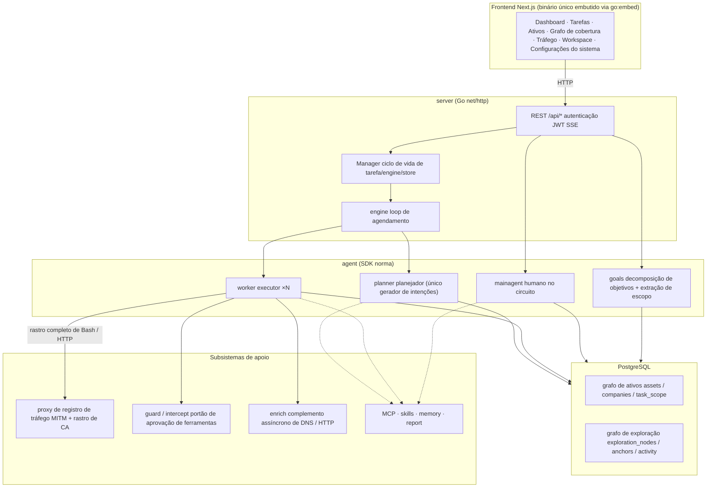
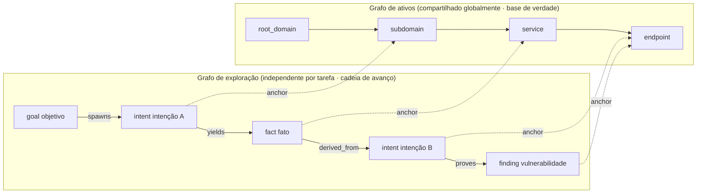
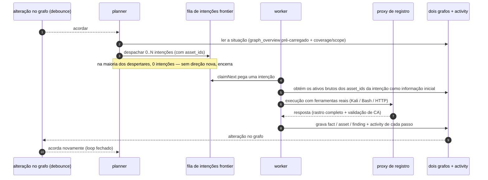
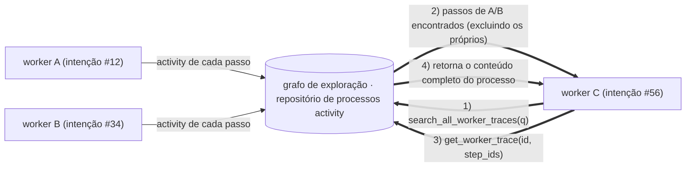
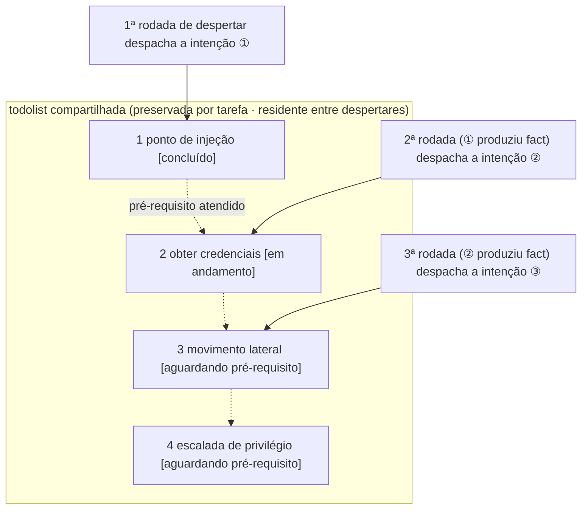

<div align="center">

# WARROOM

Sistema autônomo de pentest com IA (backend em Go + frontend em Next.js)

[](LICENSE)

</div>

---

## Detalhes do registro de aprovação

O "Registro de aprovações" global, a "Aprovação de interceptação" dentro da tarefa e os cartões de aprovação nas conversas permitem expandir para ver os detalhes. A estrutura de exibição segue o
[componente de detalhes de aprovação do AegisHook](https://github.com/RuoJi6/AegisHook/blob/main/web/src/components/CallDetail.vue), mantendo os componentes e o tema do WARROOM:


## Sincronização de ativos (ScopeSentry)

Permite sincronizar dados de ativos diretamente do ScopeSentry, dispensando a coleta repetida:

- Na página "**Sincronização de ativos**", preencha o endereço e a API Key do ScopeSentry para conectar a fonte de dados;
- Escolha os alvos e os tipos de ativo a sincronizar pela dimensão de **projeto** ou de **tarefa** (domínio / subdomínio / IP / porta / site / endpoint…);
- Importe com um clique e mescle conforme o escopo de ativos da empresa; os dados entram direto no grafo de ativos do WARROOM para o agent usar na exploração.

---

## Instalação

> Requer o banco de dados **PostgreSQL**; a exploração exige um **LLM** configurado (`ANTHROPIC_API_KEY` ou `OPENAI_API_KEY`, que também pode ser configurado na UI).

### Opção 1: script de instalação em um clique (recomendado)

```bash
git clone https://github.com/llypeDev/warroom.git
cd WARROOM
./install.sh
```

O script: detecta / instala o Docker automaticamente → permite escolher **① tudo em Docker** ou **② compilar e executar localmente**:

- **① tudo em Docker**: preencha uma senha do Postgres (Enter gera uma aleatória) → grava o `.env` automaticamente → `docker compose up -d`.
- **② execução local**: escolha o banco de dados (conectar a um existente / subir um com Docker) → gera o `config.json` → o `go` compila o binário único com frontend embutido → inicia.

Depois de instalar, abra **http://localhost:8787** (no primeiro acesso, `/setup` define a senha do administrador).

### Opção 2: Docker Compose (manual)

```bash
git clone https://github.com/llypeDev/warroom.git
cd WARROOM
cp .env.example .env          # preencha POSTGRES_PASSWORD e, opcionalmente, ANTHROPIC_API_KEY
docker compose up -d          # baixa a imagem llypeDev/warroom + postgres
# → http://localhost:8787
```

A imagem já inclui ferramentas usuais (ripgrep/curl/vim/npm/nmap…); `./skills` e `./data` são persistidos por bind mount.

O MCP remoto pode ser configurado nas configurações do sistema como `http` (Streamable HTTP) ou `sse` (SSE legado).
Serviços SSE legados normalmente usam `GET /sse` para estabelecer o fluxo de eventos e depois recebem as requisições
JSON-RPC pelo `/message?sessionId=...` devolvido pelo serviço; na configuração, preencha a URL como `/sse` e o
cabeçalho conforme `Authorization=Bearer <token>`.

### Opção 3: baixar o binário pré-compilado (Releases)

Acesse [Releases](https://github.com/llypeDev/warroom/releases) e baixe o zip da plataforma correspondente; após extrair, você obtém `warroom` + `start.sh` (`start.bat` no Windows) + `skills/` + `config.example.json`:

```bash
cp config.example.json config.json   # preencha a conexão com o database
./start.sh                           # → http://localhost:8787
```

> Use `start.sh` / `start.bat` para iniciar, em vez de executar `./warroom` diretamente. Ele é um script guardião: após o programa encerrar, decide pelo código de saída se deve reiniciá-lo, e **a [atualização com um clique](#opção-1-atualização-com-um-clique-pela-página-recomendado) na página depende dele para concluir a troca**. Ao rodar `./warroom` diretamente, o processo não é reiniciado depois da atualização.
> Para manter em segundo plano: `nohup ./start.sh >warroom.log 2>&1 &`.

### Opção 4: compilar o binário único a partir do código-fonte

```bash
# 1) exportação estática do frontend
cd web && npm ci && npm run build:static && cd ..
# 2) copie para o diretório embutido
cp -r web/out server/webui/dist
# 3) compile (-tags embedui é o que embute o frontend)
CGO_ENABLED=0 go build -tags embedui -o warroom ./cmd/warroom
./start.sh
```

### Opção 5: gerar pacotes zip de Release multiplataforma

O `build.sh` primeiro compila e embute o frontend, depois usa o linker do Go para remover as informações de depuração e compacta os arquivos de distribuição em zip. O modo Release gera por padrão pacotes zip para Linux amd64/arm64, macOS amd64/arm64 e Windows amd64:

```bash
./build.sh --release
# artefatos: dist/warroom-0.3.3-*.zip
```

Binários autoextraíveis com UPX podem ser incompatíveis com alguns kernels Linux, ambientes de virtualização ou políticas de segurança, por isso não é habilitado por padrão. Use `WARROOM_TARGETS` para personalizar os alvos; quando o ambiente de execução de destino for comprovadamente compatível, é possível passar `--upx` explicitamente para reduzir ainda mais o binário:

```bash
WARROOM_TARGETS=linux/amd64,windows/amd64 ./build.sh --release
./build.sh --target linux/amd64 --upx
```

---

## Atualização e upgrade

> O upgrade troca apenas o programa, sem tocar nos dados: o volume Postgres `pgdata`, `./data` (jwt.key / SQLite etc.) e `./skills` são preservados. **A migração do banco de dados não precisa ser executada manualmente** — o `warroom` reexecuta o `schema.sql` de forma idempotente a cada inicialização (com `ADD COLUMN` / `CREATE INDEX IF NOT EXISTS`), ou seja, "reiniciar é migrar". Ainda assim, recomenda-se fazer backup de `./data` e do banco antes de atualizar.

### Opção 1: atualização com um clique pela página (recomendado)

Na página **Configurações do sistema** (barra lateral "Configurações do sistema" → `/system/settings`), no cartão **Versão e atualizações**, é possível verificar e instalar novas versões diretamente, sem acessar o servidor.

Ao clicar em "Atualizar": baixa o pacote de distribuição da plataforma atual → compara com o `SHA256SUMS` do Release → faz um smoke test do novo binário com `-h` → mantém em espera como `warroom.new` → o programa encerra e o `start.sh` / `start.bat` o reinicia e conclui a troca. A página aguarda automaticamente até a nova versão entrar no ar e então recarrega.

- **Uma falha não deixa um programa quebrado**: se a verificação ou o smoke test não passar, o arquivo em espera é descartado e a versão atual continua rodando; se a nova versão, após a troca, falhar 3 vezes seguidas na inicialização, o sistema faz rollback automático para `warroom.old` (a que falhou fica como `warroom.failed` para diagnóstico).
- **Rollback a qualquer momento**: a versão anterior é mantida como `warroom.old`, e o cartão tem "Reverter para a versão anterior". Atenção: o esquema do banco de dados não reverte.
- **A atualização interrompe as tarefas em execução** — atualizar é reiniciar; faça isso em um momento ocioso.
- **Builds de desenvolvimento não recebem atualização**: fica desabilitado quando a versão é `dev` ou um `git describe` com sufixo, para evitar que a versão oficial sobrescreva o binário de depuração local.
- **No Docker, só o programa é trocado, não a imagem**: a toolchain da imagem (playwright / nmap etc.) não é atualizada junto e, ao recriar o container com `docker compose up -d`, volta a versão que vem na imagem. Para atualizar a imagem também, continue usando `docker compose pull warroom && docker compose up -d warroom`.
- Se o acesso ao GitHub exigir um proxy, basta configurar o **proxy global** na mesma página; o caminho de atualização passa por ele. A atualização baixa somente de domínios do GitHub e força HTTPS.

### Opção 2: script de atualização em um clique

```bash
cd WARROOM
./update.sh
```

O script primeiro oferece `git pull` opcional para puxar o código mais recente e depois permite escolher **① atualização via Docker** ou **② atualização por compilação local** (correspondendo ao `install.sh`):

- **① Docker**: é possível informar a tag da imagem de destino (Enter mantém a `WARROOM_TAG` do `.env`, padrão `latest`) → `docker compose pull` → `docker compose up -d` (reiniciar com a nova imagem já migra automaticamente).
- **② local**: reconstrói os artefatos estáticos do frontend → recompila `./warroom` (reinicie o processo para aplicar).

### Opção 3: Docker Compose (manual)

```bash
cd WARROOM
git pull                       # atualiza o compose / os scripts (opcional)
# versão específica: defina WARROOM_TAG=v0.2.0 no .env; sem isso, usa latest
docker compose pull warroom
docker compose up -d warroom     # reinicia com a nova imagem → migra o schema automaticamente
docker image prune -f          # limpa imagens antigas (opcional)
```

### Opção 4: binário pré-compilado (Releases)

Acesse [Releases](https://github.com/llypeDev/warroom/releases) e baixe o zip da nova versão; pare o processo antigo e sobrescreva `warroom` e `skills/` (preservando seu `config.json` e `data/`), depois reinicie:

```bash
cp -r <diretório-extraído>/skills ./ && cp <diretório-extraído>/warroom ./
./start.sh
```

### Opção 5: compilar a partir do código-fonte

```bash
git pull
cd web && npm ci && npm run build:static && cd ..
cp -r web/out server/webui/dist
CGO_ENABLED=0 go build -tags embedui -o warroom ./cmd/warroom
# reinicie ./start.sh
```

---

## Configuração

**Banco de dados** (`config.json`, ou sobrescrito pela variável de ambiente `WARROOM_PG_DSN`):

```json
{
  "database": {
    "host": "127.0.0.1", "port": 5432,
    "user": "warroom", "password": "yourpass",
    "dbname": "warroom", "sslmode": "disable"
  }
}
```

**LLM**: `export ANTHROPIC_API_KEY=sk-...` (ou `OPENAI_API_KEY`), e também é possível preencher na página "Configuração de LLM" da UI.
Opcional: `WARROOM_LLM_PROVIDER` / `WARROOM_LLM_MODEL` / `WARROOM_LLM_BASE_URL` / `WARROOM_LLM_PROXY`.

**Concorrência**: o número de work agents por tarefa é configurado em "Configurações do sistema" (padrão 3).

**Parâmetros usuais**: `./start.sh -addr :8787 -proxy :8788` (`-addr` frontend + API, `-proxy` proxy de gravação de tráfego). O script de inicialização repassa os parâmetros a `warroom` sem alterá-los.

### Implantação com proxy reverso (HTTPS / expor apenas 443)

O frontend e a API/SSE são servidos pela mesma porta do backend (padrão `:8787`) e o fluxo de atividades em tempo real usa por padrão a origem **same-origin**; portanto **não é necessário configurar `NEXT_PUBLIC_SSE_BASE`** — basta expor apenas a 443 na internet e manter a 8787 na rede interna.

SSE é uma conexão longa com envio contínuo, então o proxy reverso **precisa desativar o buffering**; caso contrário, o navegador conecta mas não recebe eventos (o fluxo de atividades fica girando indefinidamente). Exemplo com Nginx:

```nginx
server {
    listen 443 ssl;
    server_name your.domain.com;
    # ssl_certificate / ssl_certificate_key ...

    location / {
        proxy_pass http://127.0.0.1:8787;
        proxy_set_header Host $host;
        proxy_set_header X-Forwarded-Proto $scheme;

        # itens críticos de SSE: sem buffer, timeout longo, HTTP/1.1
        proxy_buffering off;
        proxy_cache off;
        proxy_read_timeout 3600s;
        proxy_http_version 1.1;
        proxy_set_header Connection "";
    }
}
```

> Somente quando o SSE precisar usar uma origem diferente da página (por exemplo, um subdomínio separado) é que se define `NEXT_PUBLIC_SSE_BASE` em **tempo de build** (a variável é fixada no pacote estático durante o `next build`; defini-la em tempo de execução do container não tem efeito).

---


## Desenvolvimento

### Reteste manual de vulnerabilidades

A aba "Reteste" nos detalhes da tarefa permite paginar e selecionar as vulnerabilidades desta tarefa, ver as conclusões e evidências de cada rodada e iniciar um reteste manualmente. Após iniciar, a aba atual é preservada, exibindo o ícone de carregamento e "Retestando"; quando a correção é confirmada, o status da vulnerabilidade é atualizado em conjunto.

Na área de ações de cada linha da lista de vulnerabilidades, clique em "Retestar"; ou, na área "Reteste de vulnerabilidade" dos detalhes da vulnerabilidade, clique em "Iniciar reteste" e preencha opcionalmente a versão corrigida, as condições de teste ou as limitações. O sistema cria então uma sessão de Agent de reteste independente e, após iniciar, mantém a página atual. Esse ponto de entrada existe na lista plana, no agrupamento por tarefa e na visão por ativos; durante o reteste aparece o ícone de carregamento e "Retestando", e, para acompanhar, basta clicar e entrar na sessão correspondente; ao terminar, volta a "Retestar". O reteste não exige reiniciar a tarefa de varredura original; as conclusões são "Ainda reproduzível", "Corrigido" e "Não foi possível confirmar", e a conclusão, as evidências e o link da sessão de cada rodada ficam salvos nos detalhes da vulnerabilidade.

Na primeira inicialização, o novo backend pré-instala o Agent editável "Reteste de vulnerabilidade" (`retester`), cuja prompt, LLM, orçamento de execução e ferramentas podem ser configurados no gerenciamento de Agents. Por padrão ele usa o LLM vinculado; se não houver vínculo, usa a configuração global ativa. Quando a sessão de reteste é concluída com sucesso e a conclusão é "Corrigido", o sistema muda automaticamente o status de tratamento da vulnerabilidade para "Corrigido"; em execução, falha, interrupção ou qualquer outra conclusão mantêm o status original. As evidências originais e o relatório são sempre preservados. Também é possível escolher "Corrigido" manualmente no menu suspenso de status. Se a mesma vulnerabilidade já está em reteste, a sessão existente é reutilizada; após interrupção, falha ou reinício do serviço, é possível iniciar novamente.

Nesta versão, o histórico é consultado pelos detalhes da vulnerabilidade e pelas sessões; ele ainda não entra na exportação do relatório de vulnerabilidades nem no pacote de arquivamento da tarefa e também não é associado automaticamente a pacotes de tráfego. O modo de demonstração gera apenas registros simulados claramente marcados e não faz requisições a alvos reais.

### Evidências de tráfego de vulnerabilidades

As regras de vinculação entre vulnerabilidades e tráfego, os parâmetros de envio de evidências em vários segmentos (`traffic_refs` / `evidence_hint_id`) e o impacto do interruptor de vinculação automática no conjunto de ferramentas do Agent e no consumo de Token estão em [evidências de tráfego de vulnerabilidades](docs/漏洞流量证据.md).

### Execução e testes locais

```bash
./dev.sh    # backend(:8787) + proxy de tráfego(:8788) + frontend next dev(:5173) → http://localhost:5173
```

- Backend: `go run ./cmd/warroom` (sem `-tags embedui`, o frontend não é embutido)
- Frontend: `cd web && npm run dev` (`/api` encaminhado ao backend por proxy reverso, com hot reload)
- Testes: `go test ./...`
- Prévia com Mock (sem backend): `cd web && NEXT_PUBLIC_MOCK=1 npm run dev`

---

## Arquitetura técnica do sistema

O WARROOM é um **sistema autônomo de pentest movido por múltiplos agents de LLM**: backend monolítico em Go (com frontend Next.js embutido) + PostgreSQL, com as capacidades de agent fornecidas pelo SDK `norma` incluído no repositório (`norma/agentcore` / `norma/tool` / `norma/permission` / `norma/harness` / `norma/memory` / `norma/transcript`). O núcleo é a **arquitetura de dois grafos** e, em torno dela, dois mecanismos de autonomia: a **troca de informações em nível de processo entre workers** e a **estabilização da cadeia de ataque pela todolist compartilhada entre rodadas do planner**.

### Camadas gerais



| Camada | Responsabilidade |
| --- | --- |
| **Frontend** | Exportação estática do Next.js, embutida no binário único via `go:embed`; visualiza tarefas/ativos/cadeia de exploração/grafo de cobertura e permite a conversa com humano no circuito |
| **server** | Rotas com `net/http` + autenticação JWT + SSE; o `Manager` gerencia o ciclo de vida de tarefas, engines e stores do DB |
| **engine** | Um `plannerLoop` por tarefa + N goroutines worker; retirada de intenções, timeout/pausa/drain |
| **agent** | goals / planner / worker / mainagent; o `ToolSet` expõe os dois grafos como ferramentas para o LLM |
| **db** | Persistência dos dois grafos no Postgres (pgx); o schema é criado de forma idempotente a cada inicialização via `go:embed` |
| **apoio** | Proxy MITM de registro, portão de aprovação, complemento assíncrono, MCP/skills/memória/relatórios |

### Arquitetura de dois grafos: grafo de exploração + grafo de ativos

O sistema separa "**qual é o objetivo**" e "**até onde já se testou**" em dois grafos independentes, conectados por âncoras:

- **Grafo de ativos (Asset Graph, compartilhado globalmente)**: a base de verdade dos ativos, a mesma entre tarefas. Os nós são `root_domain / subdomain / ip / service / app / endpoint` e pertencem a uma empresa; as relações pai-filho domínio→subdomínio→serviço→endpoint e as chaves de deduplicação são totalmente calculadas pelo programa — o agent envia apenas a informação bruta.
- **Grafo de exploração (Exploration Graph, independente por tarefa)**: o processo de "pensar e avançar" de uma tarefa. Os nós são `goal (objetivo) / intent (intenção) / fact (fato) / finding (vulnerabilidade) / hint (dica)` e se conectam por arestas como `spawns / derived_from / yields / proves`, formando uma **cadeia de linhagem** que responde "qual direção derivou de quais fatos e o que produziu".
- **Os dois grafos se conectam por âncoras**: `exploration_anchors(node_id, asset_id)` ancora intenções/fatos/vulnerabilidades em ativos concretos — assim é possível ver, a partir de uma "direção de exploração", quais ativos ela atingiu, e, a partir de "um ativo", rastrear quais intenções o testaram nesta tarefa e quais fatos foram obtidos. Isso também sustenta a **cobertura de testes dos ativos** e o **grafo de cobertura de ativos** (ativos no escopo + já testados em destaque).



> Divisão de trabalho: o **planner** lê a situação do grafo de exploração, avalia o objetivo e só envia **intenções** para a frontier quando há direções novas não cobertas; o **worker** pega **uma intenção**, executa com ferramentas reais e para assim que grava os novos ativos/fatos/vulnerabilidades nos dois grafos. O grafo de ativos são os fatos compartilhados; o grafo de exploração é a cadeia de avanço de cada tarefa.

### Ciclo de vida do engine e das intenções (o loop fechado de uma exploração)

O engine é um loop fechado **orientado a eventos**: quando o grafo muda, o planner é acordado; o planner despacha intenções; o worker pega a intenção, executa e grava de volta; a gravação dispara a próxima rodada — até o objetivo ser provado (`prove_goal`).



### Troca de informações em nível de processo entre workers

Em uma exploração profunda, muitas observações valiosas (um erro, um trecho de resposta, um parâmetro oculto) aparecem no **processo de execução** de um worker e não necessariamente são registradas como um fact formal. Para evitar trabalho repetido e permitir que os workers da cadeia se apoiem uns nos outros, o worker tem a capacidade de **buscar processos de outros works**:

- `search_all_worker_traces(q)`: pesquisa por palavra-chave nos **processos de execução de outros works desta tarefa** (excluindo automaticamente os passos da própria intenção), e os resultados vêm com `intent_id`;
- `list_worker_traces` / `get_worker_trace(intent_id, step_ids=[…])`: primeiro mostra quais works rodaram e depois obtém o conteúdo completo de passos específicos de um work para trocar detalhes.

Assim, mesmo que ainda não exista o fact correspondente no grafo de exploração, workers posteriores podem reutilizar observações do processo de outros — **a informação flui entre workers na granularidade do "processo de execução"**, sem mudar os limites (cada worker continua fazendo apenas a intenção que recebeu).



### todolist compartilhada entre rodadas do planner → cadeia de ataque estável

Cadeias de ataque reais costumam ser **sequências de vários passos com dependências de ordem** (por exemplo: encontrar o ponto de injeção → obter credenciais → movimento lateral → escalada de privilégio), e despachar tudo em paralelo de uma vez só gera confusão. Por isso o planner mantém uma **todolist de planejamento preservada por tarefa e compartilhada entre despertares**:

- o planner é orientado a eventos — é acordado a cada mudança no grafo, mas **cada despertar é uma sessão nova**; a todolist compartilhada permite **registrar uma vez** uma cadeia de exploração serial e, nas rodadas seguintes, **despachar intenções passo a passo conforme as dependências**, em vez de abrir a cadeia inteira de uma só vez em uma rodada;
- em cada rodada ele despacha intenção apenas para o próximo passo cujos "passos anteriores já foram concluídos e cujos facts de dependência já existem", atualizando a lista conforme o progresso (marcando como concluídos os passos já satisfeitos por facts).



Assim, a cadeia de ataque, mesmo em um ambiente "orientado a eventos + sessões sem estado", continua **avançando de forma estável, sem repetição e sem trocar a ordem** — este é o ponto-chave que permite ao WARROOM percorrer sozinho cadeias de exploração de vários passos.

---

## Referências

https://github.com/oritera/Cairn


## Licença

Este projeto é licenciado sob a **MIT License**; os termos completos estão no arquivo [LICENSE](LICENSE) na raiz do repositório.

```
MIT License

Copyright (c) 2026 Warroom contributors

Permission is hereby granted, free of charge, to any person obtaining a copy
of this software and associated documentation files (the "Software"), to deal
in the Software without restriction, including without limitation the rights
to use, copy, modify, merge, publish, distribute, sublicense, and/or sell
copies of the Software, and to permit persons to whom the Software is
furnished to do so, subject to the following conditions:

The above copyright notice and this permission notice shall be included in all
copies or substantial portions of the Software.

THE SOFTWARE IS PROVIDED "AS IS", WITHOUT WARRANTY OF ANY KIND, EXPRESS OR
IMPLIED, INCLUDING BUT NOT LIMITED TO THE WARRANTIES OF MERCHANTABILITY,
FITNESS FOR A PARTICULAR PURPOSE AND NONINFRINGEMENT. IN NO EVENT SHALL THE
AUTHORS OR COPYRIGHT HOLDERS BE LIABLE FOR ANY CLAIM, DAMAGES OR OTHER
LIABILITY, WHETHER IN AN ACTION OF CONTRACT, TORT OR OTHERWISE, ARISING FROM,
OUT OF OR IN CONNECTION WITH THE SOFTWARE OR THE USE OR OTHER DEALINGS IN THE
SOFTWARE.
```

Ou seja, você pode usar, copiar, modificar, mesclar, publicar, distribuir, sublicenciar e vender este software livremente, inclusive para uso comercial e distribuição de código fechado; a única obrigação é manter o aviso de copyright acima e este aviso de licença em todas as cópias ou partes substanciais do software.

### Dependências de terceiros

As dependências de terceiros deste projeto mantêm cada uma a sua licença original: as dependências Go estão em `go.mod`, as do frontend em `web/package-lock.json`, e `web/LICENSE` preserva o aviso MIT original do template do frontend. Ao distribuir o binário, respeite também os termos de licença dessas dependências.
